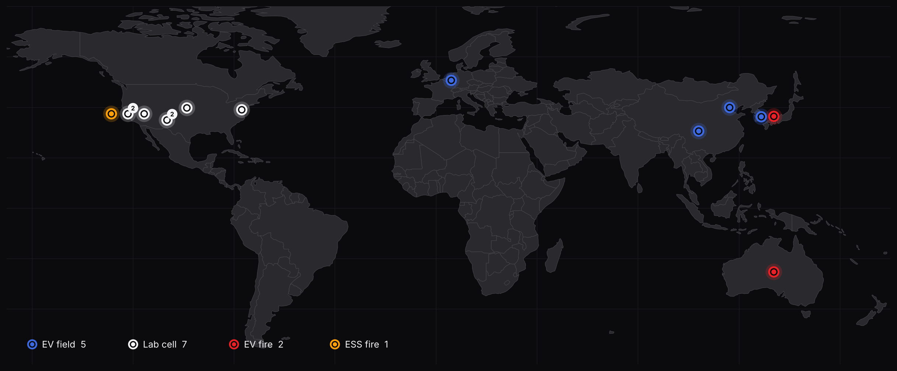

# Open Battery Data

**15 open battery datasets** for degradation (SOH / capacity fade), thermal runaway and fire risk, with how to get each one.
This repository only collects sources and download tools. It contains no analysis or models.

<p align="center">
  <a href="https://soyounson.github.io/open-battery-data/"></a>
  <br><b><a href="https://soyounson.github.io/open-battery-data/">🌏 Open the interactive map →</a></b>
</p>

| 🚗 EV field | 🔬 Lab cell | 🔥 EV fire | ⚡ ESS fire |
|:---:|:---:|:---:|:---:|
| **5** | **7** | **2** | **1** |

**Access** 🟢 Open: direct download · 🟡 Login: free account or subscription · 🔴 Request / View only: not downloadable

**Signals** `V` voltage · `I` current · `T` temperature · `SOC` state of charge · `SOH` state of health · `R` internal resistance

> **Key gap:** no open dataset links an EV's own telemetry to an actual fire on that vehicle. Telemetry and fire records exist only in separate datasets.

`n/s` = **not stated by the source**, left blank on purpose rather than guessed. Values were checked against each dataset's page or paper (November 2026). Tap a dataset name for full details, or 🌏 to see it on the map.


## 🚗 EV field data

Battery signals recorded in real vehicles.

| Dataset | Access | Country | Signals | Acquisition · interval | Chemistry | Scale |
|---|---|---|---|---|---|---|
| **[Field EV Fleet BMS Telemetry](#korea_ev_fleet)** [🌏](https://soyounson.github.io/open-battery-data/#korea_ev_fleet) | 🟡 Login | 🇰🇷 Korea | V · I · T · SOC · SOH (vendor) · Speed · Motor rpm · Odometer · R (derived) | BMS telemetry (device n/s)<br>**1 s** | NCM | 21 vehicles |
| **[EVBattery](#evbattery)** [🌏](https://soyounson.github.io/open-battery-data/#evbattery) | 🟢 Open | 🇨🇳 China | Cell V (avg / max / min) · I · Cell T (max / min) · SOC · Mileage · Capacity label · Fault label | EV charging stations (charging only)<br>**n/s (128 points per snippet)** | n/s | 464 vehicles · ~1.28 M charging snippets |
| **[RVD: 300 mass-produced NEVs](#rvd)** [🌏](https://soyounson.github.io/open-battery-data/#rvd) | 🟡 Login | ❔ n/s | V · I · SOC · SOH · Speed · Acceleration · Mileage | n/s<br>**n/s** | n/s | 300 vehicles · 104,621 cycles |
| **[Real EV dataset: Chengdu e-buses](#chengdu_bus)** [🌏](https://soyounson.github.io/open-battery-data/#chengdu_bus) | 🟢 Open | 🇨🇳 China | V · I · SOC · Surface T | CAN bus<br>**10 s** | n/s | 5 buses |
| **[BEVs in Commercial Fleets](#rwth_fleet)** [🌏](https://soyounson.github.io/open-battery-data/#rwth_fleet) | 🟢 Open | 🇩🇪 Germany | V · I · Power · SOC · Speed · Odometer · Ambient T · Capacity tests | CAN data logger (Ipetronik Fleetlog); no data while charging<br>**1 s (capacity tests 0.1 s)** | n/s | 9 vehicles |

<a name="korea_ev_fleet"></a>
<details>
<summary><b>Field EV Fleet BMS Telemetry</b> · 🟡 Login · Degradation (internal resistance)</summary>

| | |
|---|---|
| Access | 🟡 Login |
| License | CC BY 4.0 |
| Type | Degradation (internal resistance) |
| Application | EV: 20 taxis + 1 test vehicle (Kia EV6, Hyundai Ioniq 5 / 6) |
| Chemistry | NCM |
| Setting | Field |
| Amount | 21 vehicles |
| Duration | Aug 2024 – Jan 2026 |
| Max mileage | n/s |
| Signals | V · I · T · SOC · SOH (vendor) · Speed · Motor rpm · Odometer · R (derived) |
| Acquisition | BMS telemetry (device n/s) |
| Interval | 1 s |
| Label | Vendor SOH (when available); lab-measured resistance for 1 vehicle (AAM15) |
| Size | 25.5 MB (zip, Parquet) |
| Country | 🇰🇷 Korea |
| Location on map | Gyeongsangbuk-do, Korea (collection site) |
| DOI | 10.21227/0v0g-gz47 |
| Source | [IEEE DataPort](https://ieee-dataport.org/documents/field-ev-fleet-bms-telemetry-dataset) |
| Download | Manual (see source) |

</details>

<a name="evbattery"></a>
<details>
<summary><b>EVBattery</b> · 🟢 Open · Degradation + anomaly (fault)</summary>

| | |
|---|---|
| Access | 🟢 Open |
| License | CC BY 4.0 on figshare (paper says CC BY-NC-SA) |
| Type | Degradation + anomaly (fault) |
| Application | EV: 3 manufacturers (217 / 198 / 49 vehicles) |
| Chemistry | n/s |
| Setting | Field (charging) |
| Amount | 464 vehicles · ~1.28 M charging snippets |
| Duration | Several years |
| Max mileage | n/s |
| Signals | Cell V (avg / max / min) · I · Cell T (max / min) · SOC · Mileage · Capacity label · Fault label |
| Acquisition | EV charging stations (charging only) |
| Interval | n/s (128 points per snippet) |
| Label | Capacity (~586 k snippets); abnormal-vehicle label (48 vehicles) |
| Size | 1.41 GB (3 × tar.gz) |
| Country | 🇨🇳 China |
| Location on map | Tsinghua University, Beijing (institution) |
| DOI | 10.6084/m9.figshare.23301881 |
| Source | [figshare](https://doi.org/10.6084/m9.figshare.23301881) |
| Download | `python download.py evbattery` |

</details>

<a name="rvd"></a>
<details>
<summary><b>RVD: 300 mass-produced NEVs</b> · 🟡 Login · Degradation</summary>

| | |
|---|---|
| Access | 🟡 Login |
| License | CC BY 4.0 |
| Type | Degradation |
| Application | EV (new energy vehicles) |
| Chemistry | n/s |
| Setting | Field |
| Amount | 300 vehicles · 104,621 cycles |
| Duration | n/s |
| Max mileage | n/s (fleet total > 30 M km) |
| Signals | V · I · SOC · SOH · Speed · Acceleration · Mileage |
| Acquisition | n/s |
| Interval | n/s |
| Label | SOH per cycle |
| Size | 182 MB (xlsx) |
| Country | ❔ n/s |
| Location on map | Location not stated (unknown) |
| DOI | 10.21227/jyrv-2179 |
| Source | [IEEE DataPort](https://ieee-dataport.org/documents/real-world-battery-dataset-comprising-operational-data-battery-packs-300-mass-produced) |
| Download | Manual (see source) |

</details>

<a name="chengdu_bus"></a>
<details>
<summary><b>Real EV dataset: Chengdu e-buses</b> · 🟢 Open · Degradation</summary>

| | |
|---|---|
| Access | 🟢 Open |
| License | CC BY 4.0 |
| Type | Degradation |
| Application | EV: commercial e-buses |
| Chemistry | n/s |
| Setting | Field |
| Amount | 5 buses |
| Duration | n/s |
| Max mileage | n/s |
| Signals | V · I · SOC · Surface T |
| Acquisition | CAN bus |
| Interval | 10 s |
| Label | n/s |
| Size | n/s |
| Country | 🇨🇳 China |
| Location on map | Chengdu, China (collection site) |
| DOI | 10.17632/j9ky68gnd3 |
| Source | [Mendeley Data](https://data.mendeley.com/datasets/j9ky68gnd3) |
| Download | Manual (see source) |

</details>

<a name="rwth_fleet"></a>
<details>
<summary><b>BEVs in Commercial Fleets</b> · 🟢 Open · Degradation</summary>

| | |
|---|---|
| Access | 🟢 Open |
| License | CC BY 4.0 |
| Type | Degradation |
| Application | EV: geriatric-care fleet |
| Chemistry | n/s |
| Setting | Field |
| Amount | 9 vehicles |
| Duration | 2014 – 2016 |
| Max mileage | 9,062 – 15,308 km per vehicle per year |
| Signals | V · I · Power · SOC · Speed · Odometer · Ambient T · Capacity tests |
| Acquisition | CAN data logger (Ipetronik Fleetlog); no data while charging |
| Interval | 1 s (capacity tests 0.1 s) |
| Label | Capacity from periodic dynamometer tests (3.1 – 13 % fade) |
| Size | 82 MB (zip) |
| Country | 🇩🇪 Germany |
| Location on map | RWTH Aachen, Germany (institution) |
| DOI | 10.18154/RWTH-2024-01907 |
| Source | [RWTH Publications](https://publications.rwth-aachen.de/record/979878/) |
| Download | `python download.py rwth_fleet` |

</details>

## 🔬 Lab cell data

Single cells tested on a bench: cycled to end of life, or abused until thermal runaway. Not from vehicles.

| Dataset | Access | Country | Signals | Acquisition · interval | Chemistry | Scale |
|---|---|---|---|---|---|---|
| **[NASA PCoE Battery Data Set](#nasa_pcoe)** [🌏](https://soyounson.github.io/open-battery-data/#nasa_pcoe) | 🟢 Open | 🇺🇸 USA | V · I · T · Capacity · Impedance (Re, Rct) | Lab testbed (load, power supply, EIS)<br>**~10 Hz** | n/s | 18650 cells (e.g. B0005; count n/s) |
| **[NASA Randomized Battery Usage (7 sets)](#nasa_randomized)** [🌏](https://soyounson.github.io/open-battery-data/#nasa_randomized) | 🟢 Open | 🇺🇸 USA | V · I · T · Reference capacity | Lab testbed (random-walk load)<br>**n/s** | n/s | 4 cells per set |
| **[CALCE Battery Data](#calce)** [🌏](https://soyounson.github.io/open-battery-data/#calce) | 🟢 Open | 🇺🇸 USA | V · I · Capacity · R | Lab cycler<br>**n/s** | LCO (CS2, CX2, PL, PLN) · LFP (A123, K2) | CS2 15 · CX2 12 · PL 16 · A123 3 · K2 2 · PLN storage test |
| **[MIT / Stanford / TRI (Severson et al., 2019)](#severson)** [🌏](https://soyounson.github.io/open-battery-data/#severson) | 🟢 Open | 🇺🇸 USA | V · I · T (casing) · R · Capacity | Lab cycler<br>**n/s** | LFP | 124 cells |
| **[Sandia Chemistry Comparison (Preger et al., 2020)](#sandia)** [🌏](https://soyounson.github.io/open-battery-data/#sandia) | 🟢 Open | 🇺🇸 USA | V · I · T · Capacity | Lab cycler<br>**n/s** | LFP · NCA · NCM | 61 cells |
| **[NREL Battery Failure Databank](#nrel_failure)** [🌏](https://soyounson.github.io/open-battery-data/#nrel_failure) | 🟢 Open | 🇺🇸 USA | Total heat · Heat split (body / vents) · Mass ejected · X-ray video | Fractional thermal runaway calorimeter + high-speed X-ray | n/s (various commercial cells) | ~300 tests |
| **[Sandia Cell ARC Calorimetry Data](#sandia_arc)** [🌏](https://soyounson.github.io/open-battery-data/#sandia_arc) | 🟢 Open | 🇺🇸 USA | T · Self-heating rate | Accelerating rate calorimeter (ARC)<br>**n/s** | n/s | n/s |

<a name="nasa_pcoe"></a>
<details>
<summary><b>NASA PCoE Battery Data Set</b> · 🟢 Open · Degradation</summary>

| | |
|---|---|
| Access | 🟢 Open |
| License | Public (NASA) |
| Type | Degradation |
| Application | Cell (18650) |
| Chemistry | n/s |
| Setting | Lab |
| Amount | 18650 cells (e.g. B0005; count n/s) |
| Duration | Run to end of life (30 % fade, 2 Ah → 1.4 Ah) |
| Signals | V · I · T · Capacity · Impedance (Re, Rct) |
| Acquisition | Lab testbed (load, power supply, EIS) |
| Interval | ~10 Hz |
| Label | Capacity per cycle; impedance (Re, Rct) |
| Size | n/s |
| Country | 🇺🇸 USA |
| Location on map | NASA Ames, California (institution) |
| Source | [NASA PCoE repository](https://www.nasa.gov/intelligent-systems-division/discovery-and-systems-health/pcoe/pcoe-data-set-repository/) |
| Download | `python download.py nasa_pcoe` |

</details>

<a name="nasa_randomized"></a>
<details>
<summary><b>NASA Randomized Battery Usage (7 sets)</b> · 🟢 Open · Degradation</summary>

| | |
|---|---|
| Access | 🟢 Open |
| License | US Government work |
| Type | Degradation |
| Application | Cell (18650) |
| Chemistry | n/s |
| Setting | Lab |
| Amount | 4 cells per set |
| Duration | n/s |
| Signals | V · I · T · Reference capacity |
| Acquisition | Lab testbed (random-walk load) |
| Interval | n/s |
| Label | Reference charge / discharge cycles (SOH benchmark) |
| Size | n/s |
| Country | 🇺🇸 USA |
| Location on map | NASA Ames, California (institution) |
| Source | [data.nasa.gov](https://data.nasa.gov/dataset/randomized-battery-usage-5-high-temperature-right-skewed-random-walk) |
| Download | Manual (see source) |

</details>

<a name="calce"></a>
<details>
<summary><b>CALCE Battery Data</b> · 🟢 Open · Degradation</summary>

| | |
|---|---|
| Access | 🟢 Open |
| License | Citation required (CALCE + 3 papers) |
| Type | Degradation |
| Application | Cell (prismatic, pouch, cylindrical) |
| Chemistry | LCO (CS2, CX2, PL, PLN) · LFP (A123, K2) |
| Setting | Lab |
| Amount | CS2 15 · CX2 12 · PL 16 · A123 3 · K2 2 · PLN storage test |
| Duration | n/s |
| Signals | V · I · Capacity · R |
| Acquisition | Lab cycler |
| Interval | n/s |
| Label | Capacity, impedance |
| Size | xlsx / txt in zips |
| Country | 🇺🇸 USA |
| Location on map | University of Maryland, College Park (institution) |
| Source | [CALCE, Univ. of Maryland](https://web.calce.umd.edu/batteries/data/) |
| Download | `python download.py calce` |

</details>

<a name="severson"></a>
<details>
<summary><b>MIT / Stanford / TRI (Severson et al., 2019)</b> · 🟢 Open · Degradation</summary>

| | |
|---|---|
| Access | 🟢 Open |
| License | See site |
| Type | Degradation |
| Application | Cell (A123 APR18650M1A) |
| Chemistry | LFP |
| Setting | Lab |
| Amount | 124 cells |
| Duration | n/s |
| Signals | V · I · T (casing) · R · Capacity |
| Acquisition | Lab cycler |
| Interval | n/s |
| Label | Cycle life, capacity per cycle |
| Size | n/s |
| Country | 🇺🇸 USA |
| Location on map | Stanford University, California (institution) |
| Source | [data.matr.io](https://data.matr.io/1/) |
| Download | Manual (see source) |

</details>

<a name="sandia"></a>
<details>
<summary><b>Sandia Chemistry Comparison (Preger et al., 2020)</b> · 🟢 Open · Degradation</summary>

| | |
|---|---|
| Access | 🟢 Open |
| License | See site |
| Type | Degradation |
| Application | Cell (18650) |
| Chemistry | LFP · NCA · NCM |
| Setting | Lab |
| Amount | 61 cells |
| Duration | Multi-year |
| Signals | V · I · T · Capacity |
| Acquisition | Lab cycler |
| Interval | n/s |
| Label | Capacity to 80 % |
| Size | n/s |
| Country | 🇺🇸 USA |
| Location on map | Sandia National Laboratories, New Mexico (institution) |
| Source | [batteryarchive.org](https://www.batteryarchive.org/) |
| Download | Manual (see source) |

</details>

<a name="nrel_failure"></a>
<details>
<summary><b>NREL Battery Failure Databank</b> · 🟢 Open · Thermal runaway</summary>

| | |
|---|---|
| Access | 🟢 Open |
| License | See site |
| Type | Thermal runaway |
| Application | Cell (18650, 21700, D-cell) |
| Chemistry | n/s (various commercial cells) |
| Setting | Lab (abuse tests) |
| Amount | ~300 tests |
| Duration | Spreadsheet updated Feb 2024 |
| Signals | Total heat · Heat split (body / vents) · Mass ejected · X-ray video |
| Acquisition | Fractional thermal runaway calorimeter + high-speed X-ray |
| Interval | Per test |
| Label | Heat output, heat split (body / vents), mass ejected, trigger (nail, heat, internal short), X-ray video links |
| Size | Single xlsx |
| Country | 🇺🇸 USA |
| Location on map | NREL, Golden, Colorado (institution) |
| Source | [NREL / NLR](https://www.nlr.gov/transportation/battery-failure) |
| Download | `python download.py nrel_failure` |

</details>

<a name="sandia_arc"></a>
<details>
<summary><b>Sandia Cell ARC Calorimetry Data</b> · 🟢 Open · Thermal runaway</summary>

| | |
|---|---|
| Access | 🟢 Open |
| License | See site |
| Type | Thermal runaway |
| Application | Cell |
| Chemistry | n/s |
| Setting | Lab (ARC) |
| Amount | n/s |
| Duration | n/s |
| Signals | T · Self-heating rate |
| Acquisition | Accelerating rate calorimeter (ARC) |
| Interval | n/s |
| Label | Self-heating / thermal-runaway onset |
| Size | n/s |
| Country | 🇺🇸 USA |
| Location on map | Sandia National Laboratories, New Mexico (institution) |
| Source | [Sandia R&D Data Repository](https://www.sandia.gov/ess/tools-resources/rd-data-repository) |
| Download | Manual (see source) |

</details>

## 🔥 EV fire incidents

Real-world EV fire records, one row per incident. No battery signals.

| Dataset | Access | Country | What you get | Records from | Scale |
|---|---|---|---|---|---|
| **[NFA EV Fire Statistics (소방청)](#nfa_ev_fire)** [🌏](https://soyounson.github.io/open-battery-data/#nfa_ev_fire) | 🟢 Open | 🇰🇷 Korea | Date · Region · Ignition cause · Location · Floor · Vehicle state · Ignition point | Fire service incident records | One row per fire (count n/s) |
| **[EV FireSafe Global EV Battery Fire Database](#ev_firesafe)** [🌏](https://soyounson.github.io/open-battery-data/#ev_firesafe) | 🔴 Request | 🇦🇺 Australia | Cause · Charging state · Delayed / secondary thermal runaway | News, interviews, videos, fire agency and academic reports | 1,072 incidents studied |

<a name="nfa_ev_fire"></a>
<details>
<summary><b>NFA EV Fire Statistics (소방청)</b> · 🟢 Open · Fire incident</summary>

| | |
|---|---|
| Access | 🟢 Open |
| License | No usage restriction |
| Type | Fire incident |
| Application | EV |
| Chemistry | Mixed (not recorded) |
| Setting | Field |
| Amount | One row per fire (count n/s) |
| Duration | Annual updates (page updated 2026-02-12) |
| Signals | Date · Region · Ignition cause · Location · Floor · Vehicle state · Ignition point |
| Acquisition | Fire service incident records |
| Interval | Per incident |
| Label | Ignition cause (major / minor), location, floor, above / below ground, vehicle state, ignition point |
| Size | Small CSV |
| Country | 🇰🇷 Korea |
| Location on map | Korea (nationwide) (nationwide) |
| Source | [data.go.kr](https://www.data.go.kr/data/15138615/fileData.do) |
| Download | Manual (see source) |

</details>

<a name="ev_firesafe"></a>
<details>
<summary><b>EV FireSafe Global EV Battery Fire Database</b> · 🔴 Request · Fire incident</summary>

| | |
|---|---|
| Access | 🔴 Request |
| License | Not public; for-profit use needs permission |
| Type | Fire incident |
| Application | EV |
| Chemistry | Mixed |
| Setting | Field |
| Amount | 1,072 incidents studied |
| Duration | 2010 – present (updated at least every 6 months) |
| Signals | Cause · Charging state · Delayed / secondary thermal runaway |
| Acquisition | News, interviews, videos, fire agency and academic reports |
| Interval | Per incident |
| Label | Cause category, charging state, delayed / secondary thermal runaway |
| Size | — (charts only) |
| Country | 🇦🇺 Australia |
| Location on map | Australia (global database) (institution) |
| Source | [EV FireSafe](https://www.evfiresafe.com/ev-battery-fire-data) |
| Download | Manual (see source) |

</details>

## ⚡ ESS fire incidents

Failures of stationary energy storage systems. Not EV, but the closest open record of large-pack fires.

| Dataset | Access | Country | What you get | Records from | Scale |
|---|---|---|---|---|---|
| **[EPRI BESS Failure Incident Database](#epri_bess)** [🌏](https://soyounson.github.io/open-battery-data/#epri_bess) | 🔴 View only | 🇺🇸 USA | Incident list · System info · Root cause (where known) | Publicly reported incidents (linked documents) | 150 incidents (2018 – 2025) |

<a name="epri_bess"></a>
<details>
<summary><b>EPRI BESS Failure Incident Database</b> · 🔴 View only · Fire incident</summary>

| | |
|---|---|
| Access | 🔴 View only |
| License | See site |
| Type | Fire incident |
| Application | ESS (stationary storage) |
| Chemistry | Mixed (incl. LFP) |
| Setting | Field |
| Amount | 150 incidents (2018 – 2025) |
| Duration | Tracked since 2011 |
| Signals | Incident list · System info · Root cause (where known) |
| Acquisition | Publicly reported incidents (linked documents) |
| Interval | Per incident |
| Label | Root cause (where known), system info |
| Size | Web table |
| Country | 🇺🇸 USA |
| Location on map | EPRI, Palo Alto, California (institution) |
| Source | [EPRI Energy Storage Hub](https://energystorage.epri.com/hub/public/en/failure-incident-database.html) |
| Download | Manual (see source) |

</details>

## Download

```bash
python download.py --list                 # every dataset and how to get it
python download.py evbattery rwth_fleet   # specific datasets
python download.py --all                  # everything with a direct link (5 datasets)
```

- Files go to `data/<dataset>/` (git-ignored). Python 3.8+, standard library only.
- 🟡 and 🔴 datasets can't be fetched by script; `--list` prints the page to open.
- Already-downloaded files are skipped, so re-running is safe.

## Notes

- **Chemistry:** `LFP` lithium iron phosphate · `NCM` (= NMC) nickel cobalt manganese · `NCA` nickel cobalt aluminium · `LCO` lithium cobalt oxide · `Mixed` several, not separated. Don't infer chemistry from region or vehicle type when it's `n/s`.
- **Map location:** EV field data is placed where it was collected when the source says so; otherwise, and for lab data, at the publishing institution. Datasets with no stated location appear under "Location not stated".
- **Licenses:** check each one before publishing results or using data commercially. Several datasets ask you to cite specific papers (CALCE asks for at least three).
- NREL's battery pages now live at `nlr.gov`; the script uses that address.

## Contributing

Know a missing dataset, or can you confirm an `n/s` value? Edit `datasets.csv`, run `python build.py`, and open a pull request with the source link.

| File | Purpose |
|---|---|
| `datasets.csv` | Single source of truth for every dataset |
| `build.py` | Regenerates `README.md` and `assets/datasets.js` |
| `index.html` | Interactive globe and tables (GitHub Pages) |
| `download.py` | Downloads datasets that have direct links |
